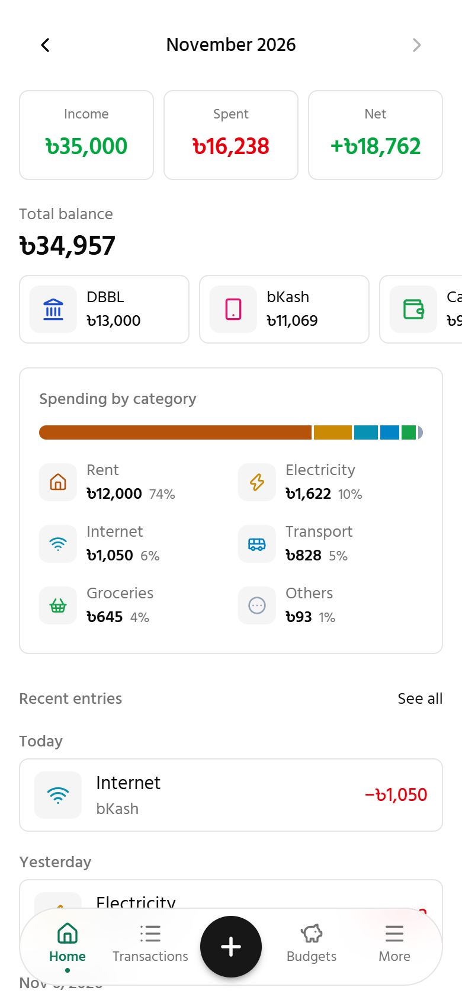
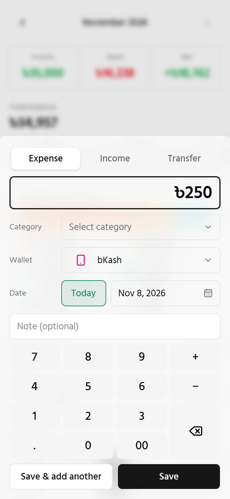
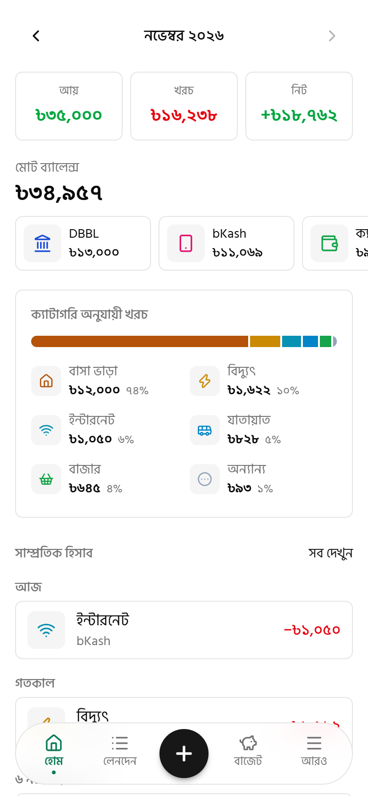
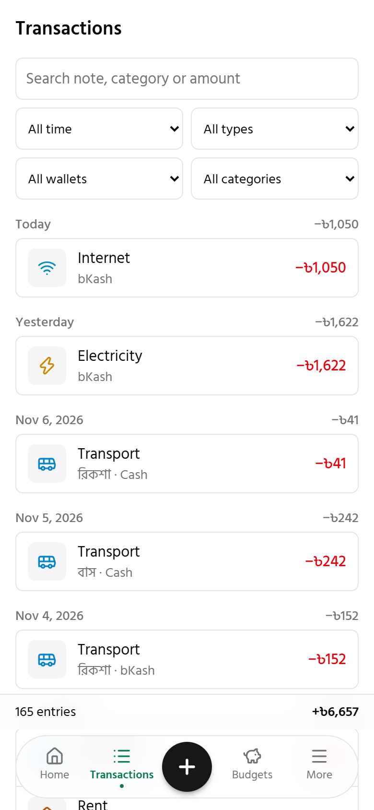
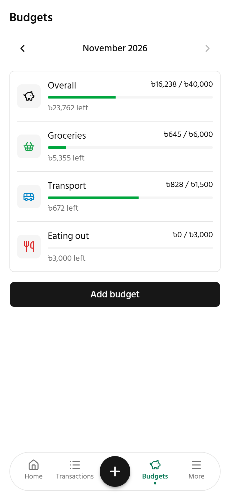
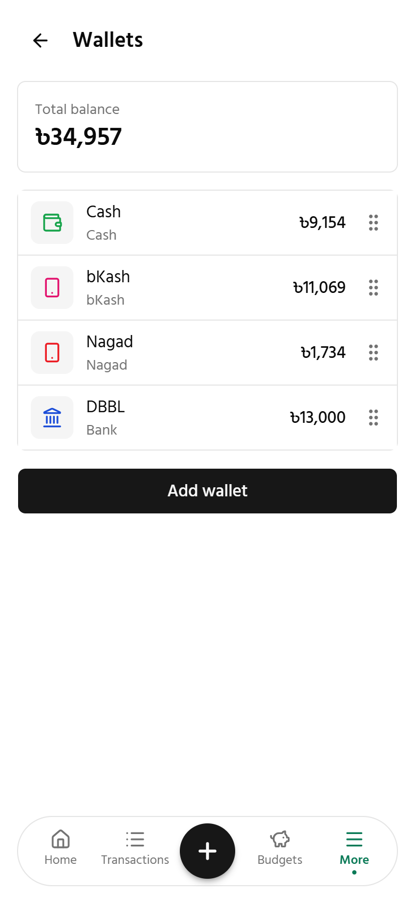
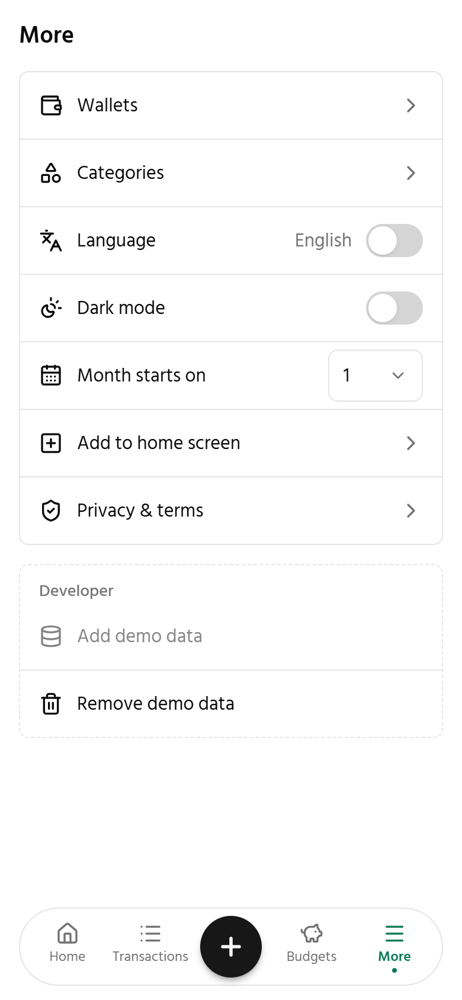

# PaiPoisha · পাই-পয়সা

**A free, bilingual (বাংলা / English) money tracker for Bangladesh.** Cash, bKash, Nagad, Rocket, bank and card, all in one place.

### 👉 Try it: **[paipoisha.vercel.app](https://paipoisha.vercel.app/)**

No download and no sign-up needed to start. Open the link on your phone and add it to your home screen.

<p align="center">
  
  
  
</p>

---

## How it works

PaiPoisha is a web app that installs like a normal app (a PWA). It is **local-first**:

1. **Everything is saved on your phone first.** Adding an entry is instant and works with no internet.
2. **Sign in with Google (optional)** to back up your data and use it on more than one device. Your entries then sync to the cloud in the background whenever you are online.
3. **Balances are always calculated from your entries**, so wallet totals never drift out of step.

Your data belongs only to your account: the cloud database locks every row to its owner, and you can delete your account and all data from **More → Account** at any time.

## How it helps

Most of us spread our money across cash, one or two mobile wallets and a bank account. By the end of the month it is hard to say where the money went. PaiPoisha helps by:

- **Showing everything in one place:** the balance of every wallet and your total, at a glance.
- **Making entry fast:** a big number pad and a quick-add link, so recording a ৳20 rickshaw ride takes seconds.
- **Showing where the money went:** spending by category for each month, with percentages.
- **Keeping you on budget:** set a monthly limit per category (or overall) and see how much is left, with a warning near the limit.
- **Speaking your language:** full Bangla and English, Bangla digits (৳১২,৫০০), and lakh-style grouping.
- **Costing nothing:** free, no ads, and it works on Android and iPhone the same way.

## How to use it

### 1. Open and install

Go to **[paipoisha.vercel.app](https://paipoisha.vercel.app/)** on your phone.

- **Android (Chrome):** tap the menu (⋮) → **Add to Home screen** / **Install app**.
- **iPhone (Safari):** tap **Share** → **Add to Home Screen**.

The app opens full screen from your home screen and works offline.

### 2. Set up your wallets

The app starts with a Cash wallet. Go to **More → Wallets** to add your own (bKash, Nagad, Rocket, a bank account, a card) and set each one's opening balance. Drag to reorder.

### 3. Add entries

Tap the big **+** button in the middle of the tab bar.

- Choose **Expense**, **Income** or **Transfer** (for example, bKash → Cash for a cash-out, with an optional fee).
- Type the amount, pick a category and wallet, and tap **Save**. Use **Save & add another** to enter several in a row.

### 4. Track and plan

| Screen | What you see |
| --- | --- |
| **Home** | This month's income, spending and net; every wallet's balance; spending by category; recent entries |
| **Transactions** | Every entry, filtered by period, wallet, category or type, with text search |
| **Budgets** | A monthly limit per category (or overall), with what is left |
| **More** | Wallets, categories, language, Bangla digits, theme (light/dark), the day your month starts (handy if your salary comes on the 25th), Google sign-in and sync |

<p align="center">
  
  
  
  
</p>

### 5. (Optional) Sign in to sync

In **More**, tap **Sign in with Google**. Entries you made before signing in are kept and uploaded. Sign in with the same Google account on every device to see the same data everywhere.

### Quick-add link

Open a link like this to get the add screen already filled in (you still tap Save):

```
https://paipoisha.vercel.app/add?type=expense&amount=150&cat=transport&wallet=bkash&note=rickshaw
```

Every part is optional. It is handy for iPhone Shortcuts or a home-screen bookmark.

---

## Contributing

Contributions are welcome: bug reports, Bangla wording fixes, and code. Please open an issue first for anything larger than a small fix, so we can agree on the approach.

### Tech stack

Next.js 16 (App Router, static export) · TypeScript · Tailwind CSS v4 · shadcn/ui · next-intl · Dexie (IndexedDB) · Supabase (Google login + Postgres with Row Level Security) · Vitest.

The app has **no server code**: it builds to plain static files (`out/`) that run fully in the browser.

### Set up the project

You need **Node.js 20.9 or newer** and **git**.

```bash
git clone https://github.com/hasnat0006/PaiPoisha.git
```

```bash
cd PaiPoisha
```

```bash
npm install
```

```bash
npm run dev
```

Open http://localhost:3000. The dev server runs **offline with demo data** and no login, so you don't need any keys to work on the app.

### Before you open a pull request

```bash
npm run check
```

This runs the type check, lint, tests and a production build. It must pass.

### Useful commands

| Command | What it does |
| --- | --- |
| `npm run dev` | Dev server at http://localhost:3000 (offline, demo data) |
| `npm test` | Unit tests (Vitest) |
| `npm run check` | Type check + lint + tests + build |
| `npm run build` | Static export to `out/` (also writes the offline service worker) |
| `npm run preview` | Serve `out/` locally, the way the real app is served |

### Testing login and sync (optional)

Sync needs your own Supabase project:

1. Create a free project at [supabase.com](https://supabase.com) and enable the **Google** auth provider.
2. Run the SQL files in `supabase/migrations/` in order (in the SQL Editor).
3. Copy `.env.example` to `.env.production.local` and fill in your project URL and anon key.
4. Run `npm run build` and then `npm run preview`.

Never commit `.env*.local` files, and never put the `service_role` key in the app.

### Project guide

- `docs/mvp-plan.md`: the full feature plan (what to build)
- `docs/progress.md`: the roadmap and what is done
- `docs/decisions.md`: why things are built the way they are
- `CLAUDE.md`: the project's hard rules (money is stored as integer paisa, every visible string goes in both `src/messages/bn.json` and `en.json`, never hard-delete synced rows, and so on)

```
src/
  app/          pages (all client-side)
  components/   UI, one folder per feature
  db/           data model and Dexie database
  features/     feature logic and hooks
  lib/          pure helpers (money, dates, …), fully tested
  messages/     bn.json and en.json
  sync/         Supabase sync engine
supabase/migrations/   database SQL
```
